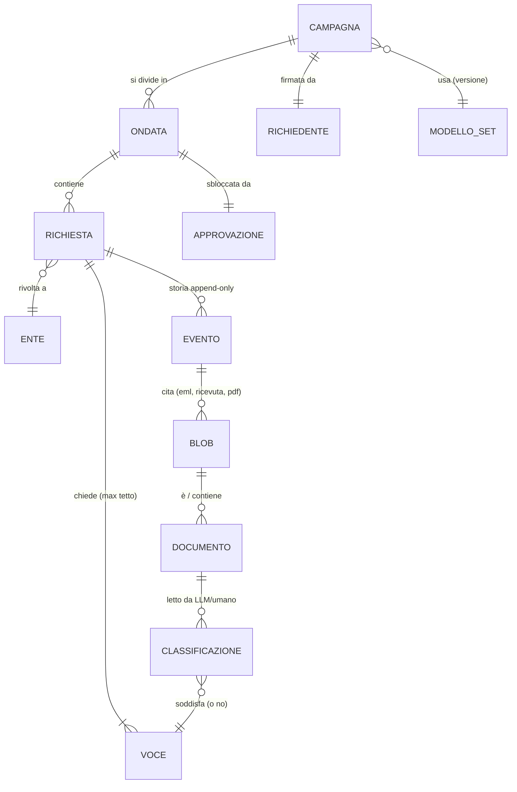
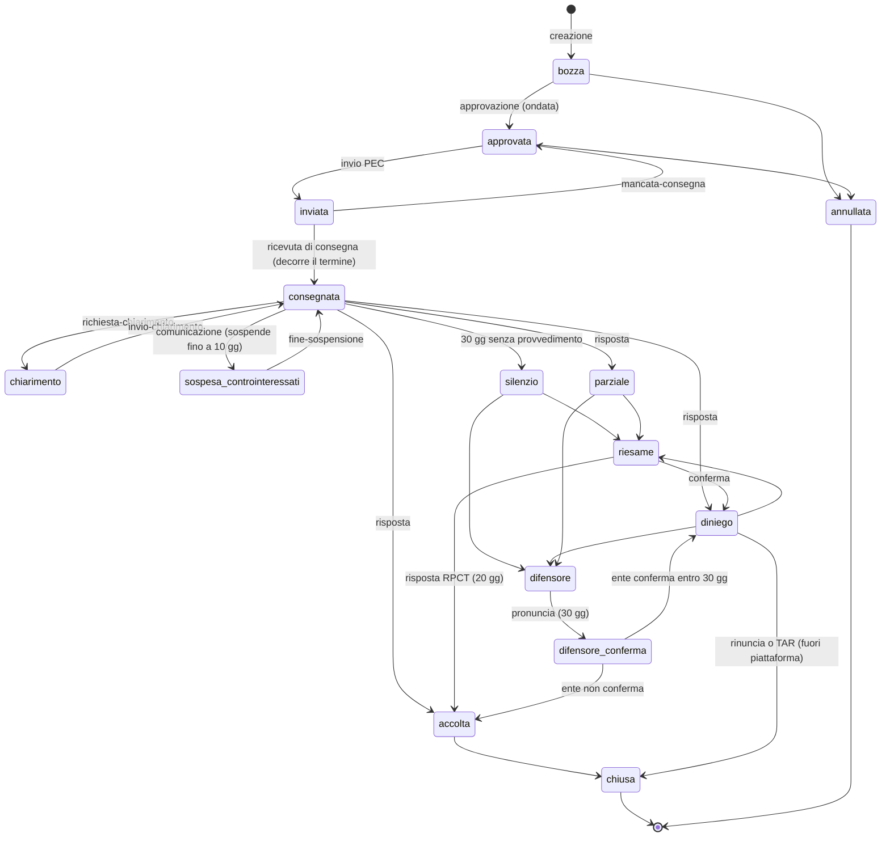
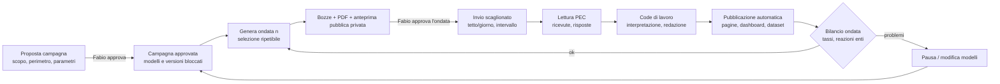
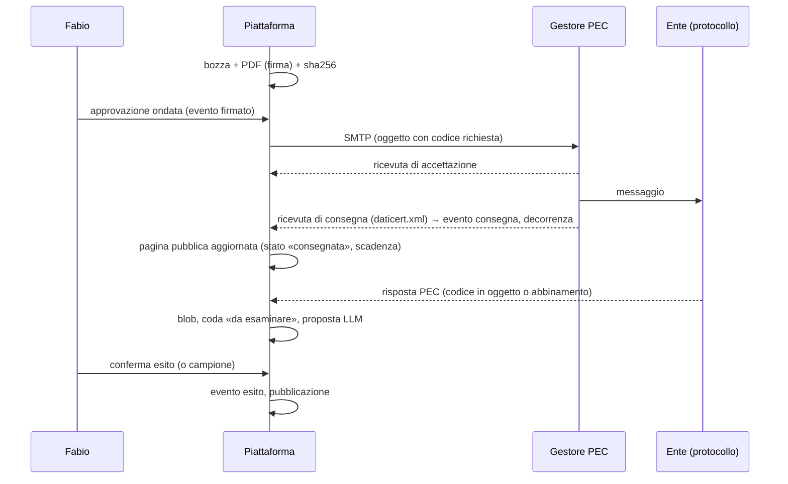
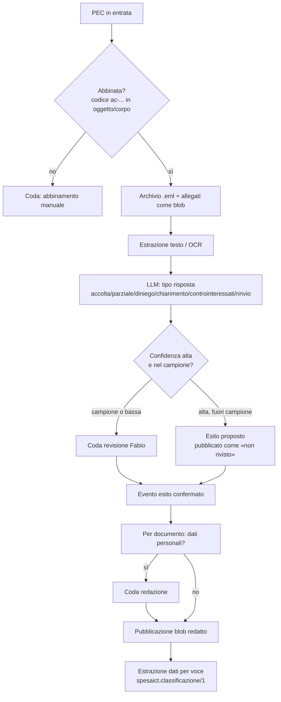

# Piattaforma di accesso civico generalizzato massivo: specifica e workflow (#58)

**Versione 0.2 bozza, 9/11/2026.** Documento da rileggere con Fabio. Costruiti (0.2) i pezzi che non dipendono dalle sue decisioni: campagna, redazione, generatore pubblico in sola anteprima (§ 2). **Nessun invio**, nessun contatto esterno.

Legenda delle affermazioni: **[V]** verificato da noi su fonte primaria archiviata in `report/metodo/prove-normativa/` (con SHA256SUMS); **[R]** riferito da terzi o da memoria, non verificato; **[I]** nostra interpretazione o proposta; **[C]** stato del codice verificato nel repository il 9/11/2026.

Documenti collegati: `report/metodo/accesso-civico-piattaforma.md` 0.3 (elenco dei mancanti, Froide/Alaveteli, punti normativi), `DECISIONI.md` (9/11: invio via PEC istituzionale al protocollo/URP, indirizzato all'ufficio preposto), `config/accesso-civico/`, `schemi/accesso-civico-*.json`, `tools/accesso_civico/`, `esiti/2026-11-09/accesso-civico/`.

## Registro revisioni

| Versione | Data | Autore | Modifiche |
|---|---|---|---|
| 0.2 bozza | 9/11/2026 | Claude (agente) | § 2 aggiornato: costruiti schema e config della campagna (`campagna.py`, campagna 0 `cmp-spesa-ict-2026` in stato «proposta»), campo `campagna` in richiesta/evento (+ `blob_sha256`, `pubblico`, `motivo_non_pubblico` nell'evento, retrocompatibili), `bozze.py` 0.2 legato alla campagna, `redazione.py` (pezzo 9, parte a regole), `pubblica.py` (pezzi 5, 10, 11 senza job notturno, DCAT e pubblicazione) solo in anteprima con dati sintetici; 23 test. |
| 0.1 bozza | 9/11/2026 | Claude (agente) | Prima stesura: requisiti 1-10 di Fabio, modello dati campagna, workflow, pubblicazione, dataset e mirror, template, richiedente e firma, ruoli/sicurezza/GDPR, separazione del repository, decisioni aperte, piano di costruzione. |

## Indice

0. Sintesi
1. Scopo, perimetro, principi
2. Stato attuale: cosa esiste e cosa manca
3. Modello dei dati (campagna → ondata → richiesta → evento → documento → classificazione)
4. Workflow
5. Operatività pubblica: pagine, dashboard, cosa non è pubblico
6. Blob content-addressed e risultati LLM
7. Dataset scaricabili e mirror da parte di terzi
8. Template di invio legale configurabile per campagna
9. Richiedente: identificazione, documento, firma
10. Risposte, interpretazione, code di lavoro, scadenze, qualità
11. Ruoli, approvazioni, registro, ripartibilità, sicurezza
12. Privacy e GDPR
13. Rischi e mitigazioni
14. Separazione in repository dedicato e riuso (Froide)
15. Decisioni aperte per Fabio
16. Pezzi da costruire, in ordine, con stima

---

## 0. Sintesi

- La piattaforma gestisce **campagne** di accesso civico generalizzato (art. 5 c. 2 d.lgs. 33/2013 [V]) verso molti enti, via **PEC istituzionale** dell'ente indirizzata all'ufficio che detiene i dati (decisione di Fabio del 9/11).
- Tutto ciò che si fa è **pubblico per costruzione**: ogni richiesta ha una pagina con la sua storia (invio, ricevute, risposte, solleciti, riesami, esito), ogni campagna ha una dashboard, tutto si scarica come dataset con manifest sha256. Restano fuori solo il documento d'identità e la firma del richiedente, i dati personali di terzi e le credenziali (§ 5.4).
- Il cuore esiste già [C]: elenco dei mancanti, 6 modelli, macchina a stati con scadenze (`stati.py`, 19 test), registro append-only, generatore di bozze, adattatore PEC secco di default (`pec.py`, 8 test). Mancano: entità **campagna**, generazione PDF con firma, **pubblicazione** (pagine, dashboard, dataset), redazione, interpretazione delle risposte, code di lavoro.
- **Raccomandazione [I]:** registro nostro (file JSONL + generatore statico), modello concettuale di Froide; repository dedicato `mxmap-it/accesso-civico` quando il primo invio è vicino (§ 14).
- **Sul documento d'identità [V+I]:** con l'invio dalla PEC del richiedente l'istanza è già valida (art. 65 c. 1 lett. c-bis CAD [V]); allegare il documento a migliaia di enti moltiplica l'esposizione di un dato personale senza necessità giuridica. Proposta: **non allegarlo di default**, inviarlo solo all'ente che lo chieda (§ 9).

## 1. Scopo, perimetro, principi

**Scopo.** Ottenere dagli enti i documenti che mancano all'analisi (contratti, convenzioni, determine per CIG), estrarne dati e misurare come la PA risponde. Le campagne possono servire altri progetti (es. mxmap.it, Osservatorio) oltre ad analisi-spesa-ict.

**Perimetro.** Accesso civico generalizzato (art. 5 c. 2) e, quando il documento è a pubblicazione obbligatoria, accesso civico semplice (art. 5 c. 1) [V, `dlgs33-art5.html`]. Non l'accesso documentale L. 241/1990 (richiede interesse qualificato) [V, art. 5 c. 3 per la non motivazione; per la 241 R].

**Principi [I].**
1. *Pubblico per default*, privato per eccezione motivata e scritta (§ 5.4).
2. *Nulla parte senza approvazione* di Fabio, per ondata (§ 11.2).
3. *Append-only*: la storia di una richiesta è una sequenza di eventi; nulla si cancella, si annulla con un evento.
4. *Content-addressed*: ogni file ricevuto o prodotto è un blob `sha256`; le pagine pubbliche lo citano per hash.
5. *Calma*: cadenza bassa, tetti per giorno e per ente, nessuna pressione sugli enti (§ 13).
6. *Verificato vs riferito* anche nelle pagine pubbliche: l'interpretazione LLM di una risposta è marcata come tale finché un umano non la conferma.
7. *Ripartibile* (regola globale): ogni job riparte dal registro, idempotente.

## 2. Stato attuale: cosa esiste e cosa manca

| Componente | Stato [C] | File |
|---|---|---|
| Elenco unico dei mancanti (28.807 voci, 6.626 enti) | **esiste**, V1-V7 ok | `tools/accesso_civico/elenco_mancanti.py`, `esiti/2026-11-09/accesso-civico/elenco-mancanti.csv.gz` |
| Destinatari (PEC IndicePA, RPCT, attendibilità A/B/C) | **in corso** sul server | `tools/accesso_civico/rpct_destinatari.py`, `destinatari.csv` |
| Modelli (istanza, sollecito, chiarimento, riesame ×2, difensore civico) | **esiste** (Markdown con segnaposti) | `config/accesso-civico/modelli/` |
| Parametri (tetto 20, ondata 0, termini, PEC) | **esiste, PROPOSTI** | `config/accesso-civico/parametri.yaml` |
| Schemi richiesta ed evento | **esiste** | `schemi/accesso-civico-{richiesta,evento}.schema.json` |
| Macchina a stati, scadenze, festivi, termine TAR | **esiste**, 19 test | `tools/accesso_civico/stati.py` |
| Generatore di bozze + registro `eventi.jsonl` | **esiste** (ondata 0: 30 enti, 501 voci) | `tools/accesso_civico/bozze.py`, `lavoro/accesso-civico/ondata-0-bozze/` (non in git) |
| Adattatore PEC (invio secco di default, lettura IMAP, ricevute `daticert.xml`) | **esiste** 0.1, 8 test; firma S/MIME delle ricevute non verificata | `tools/accesso_civico/pec.py` |
| Entità **campagna** e schema | **esiste** 0.1 (9/11): campagna 0 `cmp-spesa-ict-2026` in stato **«proposta»**, modelli con sha256 bloccabili; stato oltre «proposta» solo con riferimento a DECISIONI.md; `bozze.py` 0.2 la usa (`--campagna`, parametri sovrapposti a `parametri.yaml`, rifiuta modelli con sha256 diverso) | `schemi/accesso-civico-campagna.schema.json`, `config/accesso-civico/campagne/cmp-spesa-ict-2026.json`, `tools/accesso_civico/campagna.py` |
| PDF dell'istanza con firma calligrafa o digitale | **manca** (pec.py esige `<id>.pdf` o `.pdf.p7m` già pronto) | da fare |
| Archiviazione blob di .eml, ricevute, allegati | **parziale** (pec.py calcola sha256 dei .eml) | da collegare a `archivio/blobs/sha256/` o a un archivio dedicato |
| Interpretazione risposte (LLM + revisione) | **manca** (oggi: coda «da-esaminare») | da fare, formato `spesaict.classificazione/1` esistente |
| Redazione dei dati personali | **esiste** 0.1 a regole (9/11): richiedente (firma, documento, CF, PEC personale salvo `template.pec_richiedente_pubblica`), CF di persona fisica, IBAN (con controllo mod 97), email non istituzionali, telefoni; eventi senza percorsi privati e senza testo dei controinteressati; `residui()` come controllo finale. **Manca**: nomi di persone fisiche di terzi (LLM + revisione, § 5.5 p. 1) e redazione distruttiva dei PDF (§ 5.5 p. 2) | `tools/accesso_civico/redazione.py` |
| Pagine pubbliche, dashboard, dataset, manifest | **esiste in anteprima** 0.1 (9/11): pagine Hugo (panoramica, campagne, richieste, enti, dati), `dashboard.json` (totali e per campagna: stati, tempi mediana/p90, esiti, dinieghi per motivo, seguiti), dataset `dati/v/<data>/` + `ultima/` con `manifest.json`, `SHA256SUMS`, dizionario, licenza **segnaposto**; si ferma se `residui()` trova dati personali; uscita in `docs/` o `sito/` vietata. Anteprima con dati SINTETICI in `lavoro/accesso-civico/anteprima-pubblico/` sul server (non in git). Provato anche sulle 30 bozze reali dell'ondata 0 (nessun residuo). **Manca**: integrazione in `sito/` e pubblicazione (dec. Fabio), job notturno, DCAT-AP_IT, pagine documento | `tools/accesso_civico/pubblica.py` |
| Code di lavoro per Fabio | **manca** (solo stati) | da fare |

## 3. Modello dei dati

### 3.1 Relazioni



### 3.2 Campagna (schema da creare: `spesaict.accesso-civico-campagna/1`) [I]

| Campo | Tipo | Note |
|---|---|---|
| `formato`, `id` | `"spesaict.accesso-civico-campagna/1"`, `"cmp-<slug>"` | id stabile, compare nell'URL pubblico |
| `titolo`, `scopo` | stringhe | scopo dichiarato in pubblico (anche se non scritto nell'istanza, § 8.3) |
| `progetto` | `{nome, url, issue}` | es. analisi-spesa-ict, #58 |
| `responsabile` | `{nome, ruolo}` | chi risponde della campagna (Fabio) |
| `richiedente_id` | riferimento | al registro privato del richiedente (§ 9); in pubblico solo nome |
| `perimetro` | `{enti: criteri, documenti: criteri, periodo}` | es. «PA con voci A/B nell'elenco unico 2026-11-09» |
| `selezione` | `{sorgente: path+sha256, filtri, ordine, comando}` | ripetibilità: comando che rigenera l'insieme |
| `parametri` | `{tetto_voci, max_enti_ondata, cadenza_giorni, tetto_pec_giorno, intervallo_secondi, sollecito_dopo}` | sostituisce, per campagna, `parametri.yaml` |
| `modelli` | `{istanza: {path, sha256, versione}, ...}` | versioni bloccate all'approvazione |
| `template` | opzioni § 8 (scopo sì/no, link tracciamento, allegati) | |
| `licenza_dati` | es. `CC-BY-4.0` | § 7 |
| `stato` | `proposta → approvata → attiva → in-pausa → chiusa` | cambia solo con evento firmato da Fabio |
| `creata`, `approvata` | date + riferimento a DECISIONI.md | |

**Ondata** (oggetto leggero dentro il registro della campagna): `{id, campagna, n, enti[], richieste[], generata, approvazione: {chi, data, sha256 dell'elenco approvato}, finestra_invio: {da, a}}`.

**Richiesta, evento**: schemi esistenti [C]; da aggiungere a `richiesta` il campo `campagna` (oggi c'è solo `ondata`) e a `evento` i riferimenti `blob_sha256[]` e `pubblico: bool` con `motivo_non_pubblico`.

**Documento ricevuto**: `{sha256, mime, nome_originale, da_evento, richiesta, pagine, ocr: {motore, sha256_testo}, redatto: {sha256_redatto, revisore, data} | null, pubblico}`.

**Classificazione**: `spesaict.classificazione/1` esistente (`schemi/classificazione.schema.json` [C]) con, in più, `prompt_sha256`, `prompt_versione`, `modello`, `input_sha256`, `output_sha256`, `revisione_umana`.

### 3.3 Layout su disco [I]

```
campagne/<cmp-id>/campagna.json            # in git, pubblico
campagne/<cmp-id>/ondate/<n>/elenco.csv    # in git, pubblico
registro/eventi.jsonl                      # append-only, pubblico (eventi già filtrati)
registro-privato/                          # NON in git pubblico: identità, firma, credenziali, eml grezzi con dati di terzi
blobs/sha256/ab/cd/<sha256>                # pubblico solo se pubblico=true e redatto
pubblico/                                  # albero statico generato (pagine, dashboard, dataset)
```

## 4. Workflow

### 4.1 Ciclo di vita di una richiesta (stati di `stati.py` [C])



Termini [V, art. 5 cc. 5-8 d.lgs. 33/2013; art. 116 c.p.a.; proroga festivi art. 2963 c.c., 155 c.p.c., 52 c.p.a.]: risposta 30 gg dalla ricezione; controinteressati 10 gg; consegna dopo opposizione non prima di 15 gg; riesame deciso in 20 gg (+10 Garante); difensore civico 30 gg + 30 per la conferma dell'ente; TAR 30 gg. Presentazione del riesame entro 30 gg: circ. FP 1/2019 § 7 [V testo, natura interpretativa]. Il silenzio è inadempimento, non diniego (circ. 2/2017 § 5 [V]).

### 4.2 Ciclo di una campagna



Regola [I]: l'ondata n+1 si genera solo dopo il bilancio dell'ondata n (almeno 30 gg dall'ultimo invio o decisione esplicita di Fabio).

### 4.3 Flusso di un invio



### 4.4 Flusso di una risposta



## 5. Operatività pubblica

### 5.1 Pagine [I]

| URL (statico) | Contenuto |
|---|---|
| `/accesso-civico/` | panoramica: campagne, totali, ultime attività |
| `/accesso-civico/campagne/<cmp>/` | scopo, perimetro, criteri, parametri, modelli (con sha256 e link al testo), responsabile, stato, ondate, dashboard della campagna |
| `/accesso-civico/richieste/<ac-id>/` | ente, voci chieste (CIG, oggetto, documento atteso), testo inviato (PDF redatto della firma), cronologia eventi con date, ricevute, risposte, solleciti, riesami, scadenza corrente, documenti ottenuti, dati estratti, esito (rivisto/non rivisto) |
| `/accesso-civico/enti/<cf>/` | tutte le richieste a quell'ente, tempi, esiti |
| `/accesso-civico/documenti/<sha256>/` | metadati del documento, link al blob, classificazioni |
| `/accesso-civico/dati/` | indice dei dataset (§ 7) |

L'URL della richiesta è quello citato nell'istanza (§ 8.4): deve esistere **prima** dell'invio (pagina con stato «inviata»).

### 5.2 Dashboard (totali e per campagna)

Indicatori, calcolati solo dal registro eventi (nessun dato a mano):
- richieste: create, approvate, inviate, consegnate, mancata consegna;
- in termine / scadute in silenzio / sospese / in chiarimento;
- esiti: accolte, parziali, dinieghi **per motivo** (art. 5-bis c. 1, c. 2 lett. a/b/c, c. 3; «documento inesistente»; «richiesta massiva»; altro);
- tempi di risposta: mediana e 90° percentile in giorni dalla consegna, per ente, tipologia ISTAT, regione;
- seguiti: solleciti, riesami, difensore, esiti dei seguiti;
- documenti ottenuti (numero, pagine, voci soddisfatte / chieste), dati estratti (voci con importo/fornitore estratto);
- qualità: quota di esiti rivisti, accordo LLM/umano sul campione (§ 10.4).

Aggiornamento automatico [I]: job notturno sul server (`pubblica.py`) rigenera JSON + pagine; commit e push dell'albero → GitHub Pages (`docs/`). Grafici: JSON statico + Hugo (shortcode o JS minimale), coerente con il sito esistente `sito/` (Hugo, `hugo.toml`) [C].

### 5.3 Integrazione col sito

Opzione A [I, consigliata finché siamo in questo repository]: sezione `sito/content/accesso-civico/` generata, dati in `sito/static/accesso-civico/*.json`; Hugo produce `docs/`. Opzione B: albero statico indipendente (dopo la separazione, § 14) con dominio proprio (es. `accesso-civico.mxmap.it`), linkato dal sito. Vincolo: GitHub Pages non regge GB di PDF (limite ~1 GB per sito [R]) → i blob stanno sul mirror (§ 7), le pagine li linkano.

### 5.4 Cosa NON è pubblico e perché

| Dato | Perché | Come si tratta |
|---|---|---|
| Documento d'identità del richiedente | dato personale non necessario alla trasparenza; rischio di furto d'identità | `registro-privato/`, cifrato; mai in git pubblico; nei PDF pubblicati sostituito da «[allegato documento d'identità, non pubblicato]» |
| Immagine della firma autografa | riusabile per falsi | come sopra; nel PDF pubblico la firma è oscurata (si pubblica la versione «redatta-firma» generata dalla stessa sorgente) |
| Codice fiscale, indirizzo, telefono del richiedente | minimizzazione | solo nome e PEC (la PEC è già nell'istanza) [I: da decidere se pubblicare la PEC] |
| Dati personali di terzi nelle risposte (nomi di dipendenti oltre ai firmatari istituzionali, controinteressati, persone fisiche nei contratti: firme, CF, IBAN, indirizzi) | GDPR art. 5 c. 1 lett. c; art. 7-bis c. 4 d.lgs. 33 [R da archiviare] | redazione prima della pubblicazione (§ 5.5) |
| Comunicazioni dei controinteressati | contengono motivazioni e dati personali | pubblicato solo l'evento (data, esito), non il testo |
| Credenziali PEC, chiavi | sicurezza | solo variabili d'ambiente sul server [C pec.py] |
| Documenti dichiarati dall'ente coperti da limite parziale | rispetto del provvedimento | si pubblica solo quanto consegnato; ciò che l'ente ha oscurato resta oscurato |

Nota [I]: ciò che l'ente consegna con accesso generalizzato è, per la logica dell'istituto, conoscibile da chiunque (circ. 2/2017 [R: verificare il passaggio esatto]); ma la ripubblicazione resta soggetta al GDPR per i dati personali → redazione comunque.

### 5.5 Redazione e controllo

1. Rilevamento automatico (regex CF/IBAN/email/telefono + LLM per nomi di persone fisiche non istituzionali) → proposta di aree da oscurare.
2. Redazione **distruttiva** (rasterizzazione delle pagine toccate o rimozione del testo sotto il rettangolo; mai solo rettangolo nero sopra il testo).
3. Controllo: estrazione del testo dal PDF redatto e verifica che i valori rilevati non compaiano più (test automatico); revisione umana del 100 % per le prime ondate, poi a campione.
4. Si pubblica il blob redatto (nuovo sha256) con riferimento al blob originale (non pubblico). Evento `redazione` nel registro.

## 6. Blob content-addressed e risultati LLM

- Ogni file (istanza PDF, .eml, `daticert.xml`, allegati, testo OCR, output LLM) → `blobs/sha256/<aa>/<bb>/<sha256>` immutabile, come `archivio/blobs/sha256/` (AGENTS.md [C]).
- Attributo `pubblico` per blob; i blob privati non escono mai dal server.
- **Classificazioni/estrazioni LLM**: un record `spesaict.classificazione/1` per (documento, voce), con `modello` (nome e versione), `prompt_versione` + `prompt_sha256` (prompt in `config/accesso-civico/prompt/` versionati), `input_sha256` (testo del documento), `output_sha256` (risposta grezza archiviata come blob), parametri, data, `revisione_umana: {esito, chi, data} | null`. Rieseguibile: stesso input + stesso prompt → confronto.
- Tutti i record e i blob di output sono pubblici (sono nostri, senza dati personali se l'input è già redatto). [I] LLM solo su testo **già redatto** quando l'esecuzione è su servizio cloud; su testo integro solo in locale o via CLI in abbonamento sul server (scelta da confermare).

## 7. Dataset scaricabili e mirror

**Formati** [I]: per campagna e complessivo
- `richieste.csv` / `.parquet`, `eventi.jsonl`, `documenti.csv`, `classificazioni.jsonl`, `enti-tempi.csv` (indicatori per ente), `dizionario.md` (colonne).
- `manifest.json` per versione: elenco file con sha256, dimensione, schema, licenza, data, commit sorgente; `SHA256SUMS`.
- **Versioni datate** immutabili `dati/v/AAAA-MM-GG/` + alias `dati/ultima/` (redirect o copia).
- **Licenza** proposta: CC BY 4.0 per i nostri dati, codice AGPL/MIT come il resto [D]; i documenti degli enti: dati pubblici ex art. 7 d.lgs. 33 (riuso libero salvo dati personali) [R, `dlgs33-art7.html` archiviato da rileggere].

**Endpoint statici stabili**:
```
https://<dominio>/accesso-civico/dati/ultima/manifest.json
https://<dominio>/accesso-civico/dati/v/2026-12-01/campagne/<cmp>/richieste.csv
https://<mirror>/blobs/sha256/ab/cd/<sha256>
```

**Mirror da terzi**: l'albero è statico, quindi `wget --mirror --no-parent https://<mirror>/accesso-civico/` o `rsync` (se il bucket espone rsync, altrimenti `rclone sync` su S3 pubblico in sola lettura). Verifica con `sha256sum -c SHA256SUMS`. I blob sono immutabili: mirror incrementale banale.

**DCAT-AP_IT** [I]: utile e poco costoso: un `catalog.jsonld` / `catalog.rdf` statico (un Dataset per campagna, una Distribution per file) rende il dataset harvestabile da dati.gov.it; un finto endpoint CKAN statico (`package_show` come file JSON) è possibile ma non necessario [D].

**Coerenza col piano mirror (#17, decisione pendente di Fabio)**: proposta già in STATE.md: bucket S3-compatibile UE + nginx su mxmap.it (`mirror.mxmap.it`), Zenodo per snapshot annuali con DOI, GitHub solo indice/manifest. Qui: pagine e JSON piccoli su GitHub Pages; blob e dataset grandi sul bucket; snapshot annuale (dataset + blob pubblici) su Zenodo.

## 8. Template di invio legale configurabile per campagna

### 8.1 Opzioni del template (per campagna, in `campagna.json` → `template`)

| Opzione | Valori | Default proposto |
|---|---|---|
| `tipo_documenti` | contratto, convenzione, determina, capitolato, fattura, ordine MePA, … | da campagna |
| `voci` | elenco con CIG, oggetto, anno, importo, «documento atteso» (nome) | dall'elenco unico [C] |
| `destinatario.ufficio` | ufficio specifico se noto (attendibilità A/B), altrimenti «ufficio che detiene i dati, per il tramite del protocollo/URP» | generico (DECISIONI 9/11) |
| `destinatario.pec` | sempre PEC istituzionale IndicePA | obbligatorio |
| `dichiara_scopo` | sì / no / solo link | **solo link** [I, v. § 8.3] |
| `link_tracciamento` | sì / no | **sì** |
| `allega_documento` | sì / no / su richiesta | **su richiesta** [I, § 9] |
| `firma` | calligrafa (immagine) / PAdES / CAdES (.p7m) / nessuna | da Fabio |
| `formato_rilascio` | elettronico, file originale firmato o PDF ricercabile | sì [C, istanza.md] |
| `accesso_parziale` | richiesta esplicita di accesso parziale/oscurato in caso di limiti | sì (art. 5-bis c. 4 [V]) |

### 8.2 Oggetto e codice

Oggetto PEC: `Istanza di accesso civico generalizzato (art. 5 c. 2 d.lgs. 33/2013) – rif. ac-<ondata>-<cf>-<n>`. Il codice ripetuto nel corpo e nel nome del PDF serve all'abbinamento delle risposte (pec.py [C]). Chiedere nel testo di citare il riferimento nella risposta.

### 8.3 Indicare o no lo scopo

Norma: l'istanza «non richiede motivazione» (art. 5 c. 3 [V]).
- **Pro scopo esplicito**: trasparenza verso l'ente, riduce il sospetto di richiesta «emulativa», aiuta a ridefinire la domanda (circ. 2/2017 § 7 d [V]); coerente con l'operatività pubblica.
- **Contro**: crea l'impressione che serva, offre appigli a valutazioni sull'interesse (illegittime ma possibili), lega la richiesta a un progetto e quindi a un giudizio politico; testo più lungo.
- **Proposta [I]**: frase neutra «L'istanza fa parte di una raccolta pubblica di documenti sulla spesa ICT; lo stato della richiesta è consultabile a <link>», con la precisazione che la motivazione non è dovuta. Lo scopo pieno sta sulla pagina della campagna.

### 8.4 Link pubblici

Nel testo: link alla pagina della richiesta (stato, risposte) e alla pagina della campagna (dati estratti). Effetto atteso [I]: l'ente sa che la risposta sarà pubblica; possibile maggiore cura, possibile maggiore prudenza nelle consegne. Da misurare (§ 10.4) confrontando ondate con e senza link solo se Fabio lo vuole (esperimento A/B: decisione).

## 9. Richiedente: identificazione, documento, firma

### 9.1 Cosa dice la norma [V, `cad-art65.html`]

Art. 65 c. 1 CAD: le istanze per via telematica sono valide se, **in alternativa** («ovvero»):
- a) sottoscritte con firma digitale/qualificata/avanzata (art. 20);
- b) l'istante è identificato con SPID, CIE o CNS;
- c) **sottoscritte e presentate con copia del documento d'identità**;
- c-bis) **trasmesse dal proprio domicilio digitale** iscritto (INI-PEC/INAD) o, in mancanza, da una PEC, che vale come elezione di domicilio digitale speciale.
C. 2: equivalgono a quelle con firma autografa in presenza [V].

Art. 5 c. 3 d.lgs. 33: istanza trasmessa per via telematica secondo il CAD [V].

**Conseguenza [I]**: inviando dalla PEC del richiedente (c-bis) l'istanza è valida **senza** firma e **senza** documento. Firma calligrafa + documento (lett. c) è una seconda base, utile se un ente contesta la provenienza (caso frequente nella prassi [R]). Un'immagine della firma su PDF non è firma elettronica qualificata; vale come «sottoscrizione» ai fini della lett. c solo nell'interpretazione corrente della prassi (scansione dell'istanza firmata) [I: nessuna fonte archiviata lo afferma; da verificare].

### 9.2 Opzioni

| Opzione | Validità | Costo/rischio |
|---|---|---|
| A. Solo PEC del richiedente (c-bis) | sufficiente [V] | minimo; qualche ente chiederà il documento [R] |
| B. A + firma calligrafa sul PDF | come A; aspetto «formale» | immagine della firma da proteggere |
| C. B + documento allegato (lett. c) | doppia base | documento d'identità a migliaia di protocolli: **sconsigliato** (minimizzazione, art. 5 GDPR) |
| D. A + PAdES/CAdES (firma digitale, lett. a) | la più forte [V] | serve dispositivo/firma remota del richiedente; firma automatica massiva richiede firma remota con OTP o firma automatica (contratto con QTSP) [R] |

**Proposta [I]**: A + B di default; documento solo su richiesta dell'ente (evento `richiesta-documento` → coda di Fabio → invio mirato); D se Fabio ha firma remota automatizzabile.

### 9.3 Firma calligrafa: formato, sede, protezione

- **Fornita dal richiedente**, che la consegna lui stesso (scansione) e **autorizza per iscritto l'uso per campagna** (evento `autorizzazione-firma` con campagna, data, sha256 dell'immagine, revocabile). Senza autorizzazione valida la campagna non genera PDF.
- Formato: PNG con trasparenza, 300 dpi, ~600×200 px, solo il tratto; sha256 registrato.
- Sede: `registro-privato/richiedenti/<id>/firma.png.age` sul server, **cifrata** (es. `age` con chiave del server in file 0600 fuori dal repository), mai in git, mai nei blob pubblici, mai in log.
- Uso: decifrata in memoria al momento della generazione del PDF; il PDF inviato contiene la firma; il PDF **pubblicato** è generato dalla stessa sorgente con la firma sostituita da «[firma autografa omessa]» e ha un suo sha256 (si pubblicano entrambi gli hash, non il PDF firmato).
- Ogni PDF firmato prodotto → evento `uso-firma` (campagna, richiesta, sha256): l'elenco degli usi è visibile al richiedente.

### 9.4 Documento d'identità

Stessa custodia della firma (cifrato, privato); usato solo per invii mirati su richiesta dell'ente; mai nei dataset; scadenza del documento controllata prima di ogni uso.

### 9.5 Chi è il richiedente

Persona fisica (Fabio) o associazione (legale rappresentante, PEC dell'associazione): decisione aperta. Con un'associazione cambia il domicilio digitale (INI-PEC) e la base giuridica del trattamento.

## 10. Risposte, interpretazione, code di lavoro, scadenze, qualità

### 10.1 Gestione asincrona

Un job `leggi` ogni ora (pec.py [C]), un job `scadenze` giornaliero (stati.py `alla_data` [C]), un job `pubblica` notturno. Nessuna azione verso l'ente è automatica: solleciti, riesami e ricorsi passano da coda + approvazione.

### 10.2 Code di lavoro per Fabio

| Coda | Origine | Azione attesa |
|---|---|---|
| approvazione-ondata | ondata generata | approva / modifica / scarta |
| abbinamento | risposta senza codice | collega a richiesta |
| esame-risposta | risposta abbinata (proposta LLM) | conferma tipo ed esito |
| chiarimento | ente chiede precisazioni | approva testo `chiarimento.md` |
| controinteressati | comunicazione | solo presa d'atto; calendario sospeso |
| documento-richiesto | ente chiede documento d'identità | decidi se inviarlo |
| sollecito-pronto | scadenza superata | approva sollecito (in blocco per ondata) |
| seguito | diniego/parziale/silenzio | scegli: niente / riesame / difensore / TAR (caso per caso) |
| redazione | documento con dati personali | conferma oscuramenti |
| campione-qualità | estrazione casuale | revisione cieca |

Interfaccia [I]: niente app web all'inizio; file `code/<coda>.md` generati con comandi da eseguire (`approva.py <id>`), poi eventualmente pagina privata.

### 10.3 Diniego, riesame, difensore civico, TAR

Criteri proposti [I] per il «caso per caso»: riesame se il diniego è senza motivazione o generico (art. 5 c. 6 richiede provvedimento motivato [V]) o invoca la «massività» senza prova; difensore civico per enti territoriali quando il riesame non è stato deciso; TAR solo su documenti ad alto valore per l'analisi e con pronuncia utile anche per altri enti; costi e patrocinio (art. 116 c.p.a.: per l'accesso il ricorrente può stare in giudizio personalmente [R: da verificare su `cpa-art116.html`/art. 23 c.p.a.]).

### 10.4 Metriche di qualità

- accordo LLM/umano sul tipo di risposta e sull'esito (campione casuale ≥ 10 % per ondata, revisione cieca); soglia proposta: ≥ 95 % per pubblicare esiti «non rivisti»;
- precisione delle estrazioni (CIG, importo, fornitore) sul campione;
- redazione: 0 dati personali residui nel test automatico; fallimenti contati;
- tasso di mancata consegna e di abbinamenti manuali (qualità dei destinatari e dei codici).

## 11. Ruoli, approvazioni, registro, ripartibilità, sicurezza

### 11.1 Ruoli

| Ruolo | Chi | Può |
|---|---|---|
| Richiedente | persona/ente titolare dell'istanza | autorizza uso firma, documento; revoca |
| Responsabile campagna | Fabio | approva campagne, ondate, seguiti, pubblicazione di documenti delicati |
| Revisore | Fabio o delegati | conferma esiti, redazioni |
| Agenti (Claude) | — | preparano bozze, leggono PEC, propongono interpretazioni; **non inviano, non approvano** |

### 11.2 Approvazioni

Evento `approvazione` con `{chi, data, oggetto: ondata, sha256 elenco richieste}`; `pec.py invia` accetta solo richieste in stato «approvata» [C] e (da fare) solo se l'ondata ha approvazione valida. Invio reale solo con `--reale` + `PEC_REALE=1` [C].

### 11.3 Registro e ripartibilità

`eventi.jsonl` append-only [C]; ogni job ricostruisce lo stato dal registro (`stati.ricostruisci` [C]); invii idempotenti (un evento `invio` per richiesta, controllo prima dell'invio); lock per job; watchdog e ripresa (regola globale). Registro pubblico = filtro del registro completo (campi privati rimossi), rigenerabile.

### 11.4 Sicurezza

Credenziali solo in ambiente; segreti cifrati; utente dedicato sul server; backup cifrato del registro privato fuori dal server; verifica S/MIME delle ricevute PEC (manca [C]); nessun allegato eseguibile aperto; parsing dei .eml con libreria standard e limiti di dimensione; antivirus/sanitizzazione dei PDF ricevuti prima della pubblicazione (es. ri-render con `qpdf`/`mutool` [I]).

## 12. Privacy e GDPR [I, salvo dove indicato]

- **Titolare**: il richiedente / l'ente promotore (da decidere).
- **Base giuridica**: per i dati di terzi nei documenti, art. 6 c. 1 lett. f GDPR (interesse legittimo alla trasparenza e al controllo civico) con bilanciamento documentato, e art. 85 (giornalismo/espressione) se il progetto ha natura giornalistica [R]; per i dati del richiedente, consenso/esecuzione dell'incarico.
- **Minimizzazione**: si pubblicano solo ruoli istituzionali (firmatario, RUP) e persone giuridiche; persone fisiche terze oscurate (§ 5.5).
- **Informativa**: pagina `/accesso-civico/privacy/` (chi tratta, cosa, perché, per quanto, diritti, contatto); richiesta di rettifica/oscuramento con evento e tempo di risposta.
- **Conservazione**: blob privati originali conservati per la durata dei procedimenti + termini di ricorso; poi decisione (cancellazione è l'unica eccezione all'append-only: va documentata come evento).
- **DPIA**: consigliata per trattamento su larga scala di documenti con dati di terzi [R: criteri WP248].
- I dati personali **non** vanno a LLM cloud prima della redazione (§ 6).

## 13. Rischi e mitigazioni

| Rischio | Fonte | Mitigazione |
|---|---|---|
| Rifiuto per richiesta massiva / manifesta irragionevolezza; valutazione dell'impatto cumulativo dello stesso richiedente | circ. FP 2/2017 § 7 lett. d [V] | tetto voci per richiesta (20, proposto), una richiesta per ente per ondata, ondate distanziate, documenti identificati con precisione (CIG), disponibilità a ridefinire la domanda, mai richieste identiche già soddisfatte (§ 8 circ. [V]) |
| Carico sugli enti piccoli | [I] | tetto più basso per comuni < 5.000 ab., priorità ai documenti di importo alto |
| Reputazione (spam PEC, «raffica» di istanze) | [I] | ondate piccole, testo cortese, scopo trasparente sul link, contatto per segnalazioni, pausa se reclami |
| Limiti del gestore PEC, blocco della casella | [R § 3.11] | tetto/giorno e intervallo [C], verifica del contratto prima dell'invio |
| Pubblicazione di dati personali | GDPR | redazione + test + revisione (§ 5.5) |
| Errore LLM pubblicato come fatto | [I] | etichetta «non rivisto», campione, soglia |
| Fuga di firma/documento | [I] | cifratura, accessi minimi, eventi d'uso, revoca |
| Perdita del registro | [I] | git + backup cifrato + mirror |
| Contenzioso (diffamazione per pagine sugli enti) | [I] | solo fatti dal registro, linguaggio neutro, nessun giudizio sui singoli funzionari |

## 14. Separazione in repository dedicato e riuso

**Nome proposto**: `mxmap-it/accesso-civico` (software + modelli + schemi + generatore pubblico) e dati pubblici in `mxmap-it/accesso-civico-dati` o direttamente sul bucket.

**Va nel nuovo repository**: `tools/accesso_civico/{stati,bozze,pec}.py`, `config/accesso-civico/modelli/`, `schemi/accesso-civico-*.json`, test, generatore pubblico, prompt di interpretazione, le fonti normative pertinenti (copia di `prove-normativa/` per art. 5/5-bis, CAD 65, circolari, c.p.a.).

**Resta qui (analisi-spesa-ict)**: `elenco_mancanti.py` e `rpct_destinatari.py` (dipendono dall'imbuto e da visibilita-pa), che producono il **CSV di ingresso** di una campagna; l'estrazione dei dati per l'analisi della spesa che consuma le classificazioni. Interfaccia: `campagna.json` + `elenco.csv` in ingresso; dataset (`classificazioni.jsonl`, blob) in uscita.

**Quando**: prima del primo invio reale (così il link pubblico nell'istanza punta già al dominio definitivo) [I].

**Froide** (confronto in `accesso-civico-piattaforma.md` § 2 [V]): MIT, Django, `FoiProject` multi-ente, scadenze per legge, mediatore, modulo azioni legali. Contro, per noi: un solo richiedente, PEC invece di indirizzi per richiesta, Elasticsearch/Celery/Postgres da gestire, interfaccia pensata per molti utenti. **Raccomandazione [I]**: registro nostro + albero statico ora; Froide come **modello** (nomi degli stati, `due_date`, progetti, mediatore, pubblicazione). Rivalutare Froide come base solo se si aprono le campagne ad altri richiedenti (multi-utente): allora l'adattatore PEC diventerebbe un backend di posta di Froide.

## 15. Decisioni aperte per Fabio

1. **Richiedente**: persona fisica (Fabio) o associazione; PEC da usare (iscritta in INI-PEC?) e suoi limiti contrattuali.
2. **Firma**: calligrafa (immagine) / PAdES-CAdES / nessuna (bastando c-bis); se calligrafa, consegna dell'immagine e autorizzazione per campagna.
3. **Documento d'identità**: non allegato di default (proposta) o sempre allegato.
4. **Scopo nell'istanza**: nessuno / frase neutra con link (proposta) / scopo pieno.
5. **Link pubblico nell'istanza**: sì (proposta) / no; eventuale esperimento A/B.
6. **Pubblicità**: conferma del principio «tutto pubblico salvo § 5.4»; pubblicare o no la PEC del richiedente; pubblicare esiti «non rivisti» con etichetta.
7. **Licenza** dei dataset (CC BY 4.0 proposta) e del codice.
8. **Hosting** (#17): bucket UE + `mirror.mxmap.it` + Zenodo annuale; dominio delle pagine (`accesso-civico.mxmap.it`?).
9. **Repository dedicato**: nome e momento della separazione.
10. **Froide**: modello (proposta) o base.
11. **Parametri**: tetto voci per richiesta (20), enti per ondata (30), cadenza ondate, tetto PEC/giorno (20) e intervallo (120 s), tetto ridotto per comuni piccoli.
12. **Ondata 0**: approvazione dei 30 enti e dei 6 modelli; prima campagna da definire (`cmp-spesa-ict-2026`).
13. **Seguiti**: criteri per riesame/difensore/TAR; disponibilità a stare in giudizio.
14. **LLM**: quale modello per interpretazione/estrazione; testo integro solo in locale/CLI o anche cloud dopo redazione.
15. **Titolare del trattamento**, informativa, DPIA.
16. **Code di lavoro**: file Markdown + comandi (proposta) o piccola interfaccia web privata.

## 16. Pezzi da costruire, in ordine (stime indicative di lavoro agente, esclusi tempi di attesa)

| # | Pezzo | Dipende da | Stima |
|---|---|---|---|
| 1 | Schema campagna + campo `campagna` in richiesta/evento, migrazione ondata 0 in `cmp-spesa-ict-2026` | — | 0,5 g |
| 2 | Approvazione per ondata (evento firmato, controllo in `pec.py invia`) | 1 | 0,5 g |
| 3 | Generatore PDF dell'istanza (Markdown → PDF), versione inviata con firma e versione pubblica senza; custodia cifrata di firma e documento | 1, dec. 2-3 | 1,5 g |
| 4 | Archivio blob per .eml, ricevute, allegati (+ verifica S/MIME ricevute) | — | 1 g |
| 5 | Generatore pubblico minimo: pagina richiesta + campagna, registro pubblico filtrato, Hugo (`sito/content/accesso-civico/`) | 1, 4, dec. 6 | 2 g |
| 6 | Code di lavoro (file + comandi `approva/esito/seguito`) | 1 | 1 g |
| 7 | Primo invio dell'ondata 0 (da Fabio) e misura | 1-6, dec. 1-5, 11-12 | — |
| 8 | Interpretazione risposte LLM + campione di qualità | 4, 6, dec. 14 | 2 g |
| 9 | Redazione automatica + test di residui + coda | 4 | 2 g |
| 10 | Dashboard (indicatori § 5.2) e job notturno di pubblicazione | 5, 8 | 1,5 g |
| 11 | Dataset versionati + manifest + SHA256SUMS + DCAT-AP_IT | 5, dec. 7-8 | 1,5 g |
| 12 | Mirror su bucket + istruzioni + snapshot Zenodo | 11, dec. 8 | 1 g |
| 13 | Estrazione dati per voce (`spesaict.classificazione/1`) e ritorno all'analisi | 8 | 2 g |
| 14 | Separazione nel repository dedicato | 1-6, dec. 9 | 1 g |
| 15 | Informativa privacy, DPIA (bozza per Fabio) | dec. 15 | 0,5 g |

**Avanzamento 0.2 (9/11):** fatti 1 (senza migrazione dell'ondata 0, che si rigenera con `bozze.py --campagna` quando Fabio decide), 9 in parte (regole, senza LLM né PDF), 5/10/11 in anteprima (senza pubblicazione, job notturno, DCAT). Test: `.venv/bin/python -m unittest tests/test_accesso_civico_pubblico.py`.

Totale indicativo ≈ 18 giorni-agente; il minimo per un primo invio pubblicamente tracciato è 1-6 (≈ 6,5 g).
